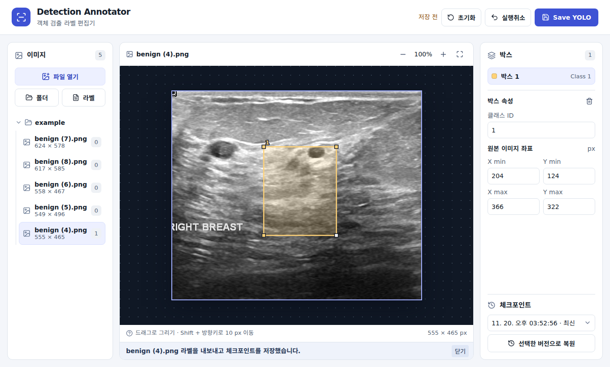

# Detection Annotator

브라우저에서 이미지의 바운딩 박스를 편집하고 YOLO Object Detection 라벨을 저장하는 Next.js 페이지입니다. 별도 서버 API 없이 `/annotator`에서 실행됩니다.

## 실행 화면



`example/benign (4).png`로 캡처한 실제 실행 화면입니다. 왼쪽에서 이미지를 선택하고 중앙에서 예시 박스를 그렸습니다. 오른쪽에서 클래스 ID, 원본 픽셀 좌표, 저장한 체크포인트를 확인할 수 있습니다.

**캡처에 사용한 원본 이미지**


## 주요 기능

| 기능 | 동작 |
| --- | --- |
| 파일·폴더 열기 | 파일 선택과 드래그 앤 드롭을 지원합니다. 중첩 폴더는 원래 구조대로 펼치고 접을 수 있습니다. |
| 박스 편집 | 마우스로 그리기·이동·크기 조절을 하고, 방향키나 숫자 입력으로 미세 조정합니다. |
| 확대·축소 | 이미지와 박스를 함께 확대하거나 축소합니다. 좌표는 원본 픽셀 기준입니다. |
| 초기화·실행취소 | 현재 이미지의 박스를 모두 지우거나 마지막 편집 단위를 되돌립니다. |
| YOLO 저장·복원 | 이미지별로 정규화된 라벨을 다운로드하고 브라우저에 저장한 체크포인트를 복원합니다. |

## 실행

Node.js 20.9 이상과 npm이 필요합니다. 이 폴더에서 실행합니다.

```bash
npm ci
npm run dev
```

브라우저에서 [http://localhost:3000/annotator](http://localhost:3000/annotator)를 엽니다. 원격 VS Code에서 실행 중이면 **Ports** 탭에서 3000번 포트를 전달하고 전달된 주소에 `/annotator`를 붙입니다. 터미널에 다른 포트가 표시되면 그 포트를 사용합니다.

## 사용 가이드

1. **파일 불러오기.** **폴더** 버튼으로 이 프로젝트의 `example` 폴더를 엽니다. 왼쪽에서 `example`을 펼치고 `benign (4).png`를 선택합니다. 파일이나 폴더를 작업 영역으로 끌어다 놓아도 됩니다. 이미지와 이름이 같은 기존 `.txt`를 함께 열거나 **라벨** 버튼으로 불러오면 YOLO 박스가 나타납니다.
2. **박스 편집.** 이미지의 빈 곳에서 드래그해 새 박스를 그립니다. 박스 안쪽을 드래그해 통째로 옮기고, 꼭짓점을 드래그해 크기를 조절합니다. 꼭짓점을 한 번 클릭하고 방향키를 누르면 원본 기준 1픽셀, Shift를 함께 누르면 10픽셀씩 움직입니다. 오른쪽의 `X min`, `Y min`, `X max`, `Y max`에 값을 입력한 뒤 Enter를 누르거나, 필드에 초점을 둔 상태에서 ↑/↓를 눌러 박스가 바뀌는지 확인합니다. 여러 클래스를 구분하려면 **클래스 ID**를 수정합니다.
3. **실행취소와 초기화.** 박스를 한 번 드래그하고 **실행취소**를 누르면 드래그 전으로 돌아갑니다. 같은 꼭짓점을 선택한 채 방향키를 10번 누른 뒤 실행취소를 한 번 누르면 10번 누르기 전 좌표로 돌아갑니다. **초기화**는 현재 이미지의 박스를 모두 지우고, 실행취소로 되돌릴 수 있습니다. 편집 실행취소 기록은 페이지가 열린 동안 이미지별로 유지됩니다.
4. **확대·축소.** 중앙 상단의 확대, 축소, 화면에 맞추기를 차례로 누릅니다. 화면에서 이미지와 박스가 함께 커지거나 작아지고, 오른쪽의 원본 픽셀 좌표는 유지돼야 합니다. 확대된 영역은 스크롤로 이동할 수 있습니다.
5. **YOLO 저장.** **Save YOLO**를 누른 뒤 브라우저 다운로드 목록의 `benign (4).txt`를 엽니다. 각 줄은 `class_id x_center y_center width height` 순서입니다. 예를 들어 400 × 200 이미지에 클래스 2, 좌표 `(100, 50)–(300, 150)`인 박스 하나를 저장하면 아래 한 줄이 나옵니다.

   ```text
   2 0.5 0.5 0.5 0.5
   ```

6. **체크포인트 복원.** 박스를 이동하고 **Save YOLO**를 다시 누릅니다. 오른쪽 체크포인트 목록에서 첫 번째로 저장한 시점을 골라 **선택한 버전으로 복원**을 누르면 첫 저장 당시의 좌표가 표시됩니다. 복원 결과를 새 체크포인트로 남기거나 다시 다운로드하려면 **Save YOLO**를 누릅니다. 새로고침한 뒤에도 가장 최근 저장 시점의 이미지와 박스가 표시되고, 이전 체크포인트를 다시 선택할 수 있습니다.

선택한 이미지와 체크포인트는 저장을 누른 시점에 해당 브라우저의 IndexedDB에 기록됩니다. 다운로드 위치는 브라우저 설정을 따릅니다.

## 코드 검증

```bash
npm run typecheck
npm run build
```

페이지 진입점은 `src/app/annotator/page.tsx`이고, 편집 UI와 파일·체크포인트 로직은 `src/components/annotator/`에 있습니다.

한글 글꼴은 SIL Open Font License의 Noto Sans KR을 사용합니다. [글꼴 원본 및 라이선스](https://github.com/google/fonts/tree/main/ofl/notosanskr)
